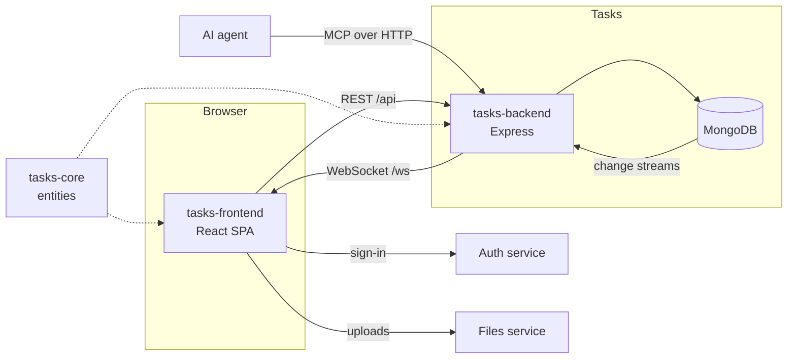

# Tasks

A task and project manager with tags, sub-tasks, recurring tasks, rich-text notes, and file attachments — with real-time sync across devices and an MCP server that lets AI agents read and manage your tasks.

**Live:** [tasks.olegpoliakov.dev](https://tasks.olegpoliakov.dev)

<!-- TODO: add a screenshot, e.g.  -->

## Repositories

This is an overview repository. The code lives in three repositories, one per layer:

| Repository | Package | What it is |
|---|---|---|
| [tasks-core](https://github.com/olegpolyakov/tasks-core) | `@olegpolyakov/tasks-core` | Domain entities (Task, Project, Tag, Settings) shared by the backend and frontend. Published to GitHub Packages. |
| [tasks-backend](https://github.com/olegpolyakov/tasks-backend) | `@olegpolyakov/tasks-backend` | Node.js service: REST API, WebSocket change feed, and MCP server. Deployed as its own container. |
| [tasks-frontend](https://github.com/olegpolyakov/tasks-frontend) | `@olegpolyakov/tasks-frontend` | React single-page app served by nginx. Deployed as its own container. |

## Features

- **Tasks** with due dates, priority, sub-tasks, rich-text notes, tags, and file attachments
- **Recurring tasks** — daily, weekly, monthly, and yearly schedules
- **Projects** with sections to group related tasks
- **Real-time sync** — changes made on one device appear on others instantly
- **Guest mode** — try the app without an account; data stays in the browser session
- **AI-ready** — an MCP server exposes tasks, projects, and tags as tools for AI agents
- **Localized** in English and Russian

## Architecture

- **tasks-core** holds the domain model as plain TypeScript classes. The backend and frontend both depend on it, so each entity is defined once and shared by both sides.
- **tasks-backend** serves three interfaces from one process:
  - `/api` — REST endpoints for tasks, projects (and their sections), tags, and user settings
  - `/ws` — a WebSocket feed. MongoDB change streams detect inserts and updates, and the backend pushes them to the user's connected clients.
  - `/mcp` — a [Model Context Protocol](https://modelcontextprotocol.io) server over streamable HTTP (see below)
- **tasks-frontend** is organized by feature (`tasks`, `projects`, `tags`), each with its own API client, state, hooks, and components. Every feature has a remote API client and an in-memory one, and guest mode switches to the in-memory client.
- **Shared platform:** Tasks is one of several apps built on the same shared packages — `@olegpolyakov/core`, `backend`, `frontend`, `ui` (component library), and `editor` (rich-text editor). Sign-in is handled by a separate auth service and file uploads by a separate files service.

## MCP server

The backend exposes 21 tools — count, list, find, get, create, update, and delete for each of tasks, projects, and tags (for example `listTasks`, `createTask`, `findProject`).

- Requests are authenticated with the same JWT as the web app.
- Every tool takes a `userId`, and the server rejects calls where it doesn't match the authenticated user, so an agent can only touch its user's data.
- Tool input schemas are defined once and converted to Zod schemas when the server registers them.

## Tech stack

| Layer | Technologies |
|---|---|
| Frontend | TypeScript, React 19, React Router, Jotai, i18next, Sass, Vite, Lexical (via `@olegpolyakov/editor`) |
| Backend | TypeScript, Node.js, Express, MongoDB, WebSocket (`ws`), MCP SDK, Zod |
| Testing | Vitest |
| Infrastructure | Docker, nginx, Dokploy, GitHub Packages |